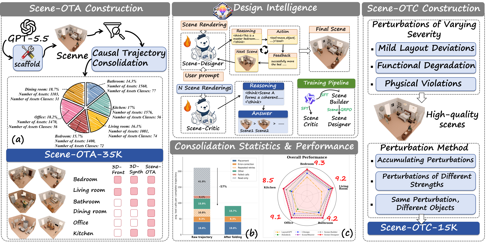
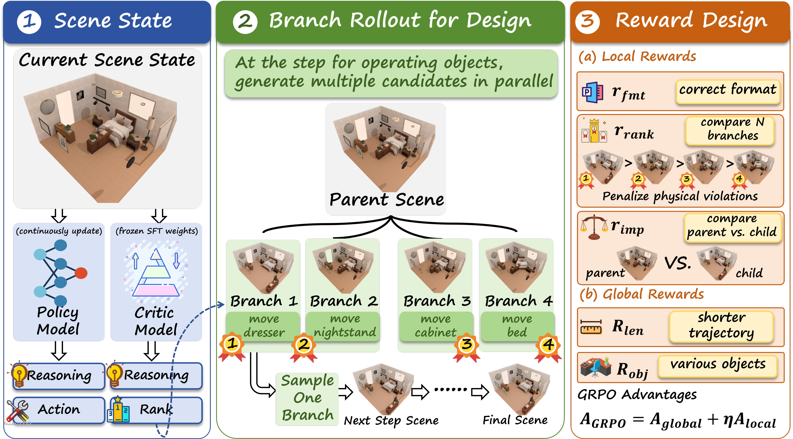

<div align="center">
  <h1>&nbsp; Scene-Designer</h1>
  <p><strong>Learning Design Intelligence for Agentic 3D Scene Generation</strong></p>
  <p>Xuanyu Liu*, Hongyan Feng*, Miao Pan, Sunlai Chen, Lizhou Liang, Bing Sun, Wenqi Zhang, Xuhong Zhang</p>
  <p>Zhejiang University · Universal Identification Technology (Hangzhou) Co., Ltd.</p>
  <p><strong>OmniAI Group of ZJU ACES Lab</strong><br><sub>* Equal contribution</sub></p>
  <p>
    <a href="https://arxiv.org/abs/2610.23121"></a>
    <a href="https://zju-omniai.github.io/Scene-Designer/"></a>
    <a href="https://huggingface.co/XuanyuLiu/Scene-Builder-Qwen3-VL-8B-Instruct"></a>
    <a href="https://huggingface.co/datasets/XuanyuLiu/Scene-OTC-Bench"></a>
    <a href="https://github.com/ZJU-OmniAI/Scene-Designer"></a>
  </p>
  <p><a href="requirements.txt"></a></p>
</div>

## 🎬 Introduction Video

<p align="center">
  <a href="https://zju-omniai.github.io/Scene-Designer/#overview-video">
    
  </a>
</p>

[Open video directly](https://zju-omniai.github.io/Scene-Designer/assets/videos/scene-designer-overview-en.mp4?v=20261019-title-ava) · [Watch on the project page](https://zju-omniai.github.io/Scene-Designer/#overview-video)

## 📖 Overview

**Scene-Designer** learns **design intelligence**: the ability to both **design a scene** and **critique its quality**.

**Scene design** concerns constructing physically valid, functionally correct, and layout-coherent scenes, while efficiently correcting errors without unnecessary trial and error when problems arise. **Scene critique** focuses on assessing scene quality along the same dimensions and distinguishing better designs from poorer ones. These two capabilities are closely connected, since effective design requires reliable critique to guide construction, while meaningful critique requires an understanding of what constitutes good scene design.

<p align="center">
  
</p>

## 🧭 Learning from Design and Critique Experience

Two complementary sources of supervision teach construction decisions and scene-quality assessment:

- **Scene-OTA-35K:** Observation–Thought–Action experience. Causal Trajectory Consolidation removes ineffective operations without downstream contributions while retaining effective decisions and necessary intermediate states.
- **Scene-OTC-15K:** Observation–Thought–Critic experience. Scene perturbations introduce layout deviations, functional degradation, and physical violations to construct scene preference comparisons.

<p align="center">
  
</p>

## 🧠 From Scene-Builder to Scene-Designer

Joint supervised fine-tuning develops scene construction and critique capabilities, producing **Scene-Builder**. **Scene-GRPO** then uses a frozen Critic to evaluate candidate edits through two complementary local rewards:

- **Branch-ranking reward:** compares sibling scenes generated from the same parent to favor better design decisions.
- **Improvement reward:** compares each child scene with its parent to assess actual progress and discourage ineffective modifications.

Global length and object-completeness rewards support efficient, complete scene construction.

<p align="center">
  
</p>

## 📦 Models and Data

| Resource | Description | Access |
| :--- | :--- | :---: |
| **Scene-Builder-Qwen3-VL-8B-Instruct** | Full SFT checkpoint, initialized from Qwen3-VL-8B-Instruct | [🤗 Model](https://huggingface.co/XuanyuLiu/Scene-Builder-Qwen3-VL-8B-Instruct) |
| **Scene-OTC-Bench** | 94 two-scene comparisons and 55 four-scene ranking questions | [🤗 Dataset](https://huggingface.co/datasets/XuanyuLiu/Scene-OTC-Bench) |

The published weights are the **Scene-Builder SFT stage**, before Scene-GRPO. Scene-OTC-Bench is held out for evaluation; do not mix it into training.

## 🚀 Quick Start

### 1. Clone the repository

```bash
git clone https://github.com/ZJU-OmniAI/Scene-Designer.git
cd Scene-Designer
```

### 2. Prepare the environment

Use Linux and Python 3.11. Follow the [installation guide](USAGE.md#installation) to install the model dependencies and prepare the separately downloaded **SceneSmith** checkout, integration patch, geometry services, and assets.

SceneSmith is not bundled in this repository. The setup script applies the required changes; our code stays in this directory.

### 3. Download the model

```bash
hf download XuanyuLiu/Scene-Builder-Qwen3-VL-8B-Instruct \
  --local-dir model/Scene-Builder-Qwen3-VL-8B-Instruct
```

All commands run from the repository root. Visual policy stages use **one top-down view and four oblique views**, ordered topdown → south → east → west → north. Floor-plan generation is text-only; Critic inputs are candidate scenes. See the [observation contract](USAGE.md#observation-contract).

## 🛠️ Data Preparation

This release provides the processing stages after raw trajectory collection:

| Pipeline | Included steps | Guide |
| :--- | :--- | :--- |
| **Scene-OTA** | Trajectory compression, evidence checks, five-view preparation, CoT annotation | [Trajectory processing](USAGE.md#1-compress-trajectories-and-annotate-cot) |
| **Scene-OTC** | Scene perturbations, candidate rendering, ranking and CoT annotation, SFT conversion | [Scene-OTC construction](USAGE.md#2-construct-scene-otc) |

## ⚙️ Training

After preparing the environment and SFT data, fine-tune the model:

```bash
python -m src.train_sft \
  --model-path model/Scene-Builder-Qwen3-VL-8B-Instruct \
  --sft-root datasets/sft --repo-root . \
  --output-dir model/scene_builder_sft \
  --num-epochs 3 --per-device-batch-size 1 --grad-accum 8 --max-pixels 65536
```

See [SFT](USAGE.md#3-sft) for data validation and LoRA options, and [Scene-GRPO](USAGE.md#4-scene-grpo) for the RL command, frozen Critic, reward computation, and memory requirements. The released RL entrypoint optimizes furniture construction; SFT and inference support floor plan, furniture, wall, and ceiling stages.

## 🏠 Generate Scenes

Start the SceneSmith tool server in one terminal:

```bash
python -m uvicorn src.tool_server:app --host 127.0.0.1 --port 18000
```

In a second terminal, activate the same environment and run:

```bash
python -m src.rollout_client --server-url http://127.0.0.1:18000 \
  --model-dir model/Scene-Builder-Qwen3-VL-8B-Instruct \
  --prompt 'Design a warm bedroom with a bed, bedside storage, and a reading corner.' \
  --config scene_designer --max-steps-per-stage 30 --keep-server-alive
```

The policy executes scene tools and receives five fresh views at each visual stage. See [scene generation](USAGE.md#5-generate-scenes) for Critic-guided branching and saved outputs.

## 🏗️ Repository Layout

```text
Scene-Designer/
├── trajectory_compression/  offline trajectory compression
├── tools/                   CoT annotation and data conversion
├── src_critic/              perturbations, ranking labels, and Critic rewards
├── src/                     SFT, Scene-GRPO, and scene-generation inference
├── Designer/               SceneSmith runtime adapters
├── prompts/                 policy instructions and tool schemas
├── integration/             external SceneSmith patch and configuration
├── scripts/                 setup and execution helpers
├── website/                 project page, videos, and website assets
├── USAGE.md                 detailed installation and workflow commands
└── VALIDATION.md            executed checks and remaining verification limits
```

## 🙏 Acknowledgements

We thank the authors and maintainers of [SceneSmith](https://github.com/nepfaff/scenesmith), [Qwen3-VL](https://huggingface.co/Qwen/Qwen3-VL-8B-Instruct), [Transformers](https://github.com/huggingface/transformers), and [PEFT](https://github.com/huggingface/peft) for their open-source work.

SceneSmith remains an external dependency; its license notice is retained in [integration/SceneSmith-LICENSE](integration/SceneSmith-LICENSE). Third-party checkpoints, generators, and scene assets remain subject to their respective licenses.

## 📝 Citation

```bibtex
@misc{liu2026scenedesigner,
  title  = {Scene-Designer: Learning Design Intelligence
            for Agentic 3D Scene Generation},
  author = {Xuanyu Liu and Hongyan Feng and Miao Pan
            and Sunlai Chen and Lizhou Liang and Bing Sun
            and Wenqi Zhang and Xuhong Zhang},
  year   = {2026},
  eprint = {2610.23121},
  archivePrefix = {arXiv},
  primaryClass = {cs.CV},
  url = {https://arxiv.org/abs/2610.23121}
}
```

## ✉️ Contact

Xuanyu Liu: [22651306@zju.edu.cn](mailto:22651306@zju.edu.cn).
